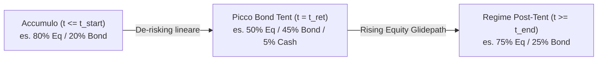

# 10 — Asset Allocation Multi-Asset, Ribilanciamento e Glidepath (Bond Tent)

## 1. Obiettivo e Motivazione

Nel motore attuale di FireIta ([`src/lib/engine/types.ts`](file:///Users/rlupi/src/fire/FireIta/src/lib/engine/types.ts), [`src/lib/engine/montecarlo.ts`](file:///Users/rlupi/src/fire/FireIta/src/lib/engine/montecarlo.ts) e [`src/lib/engine/projection.ts`](file:///Users/rlupi/src/fire/FireIta/src/lib/engine/projection.ts)), il portafoglio è rappresentato come un **unico contenitore indistinto** governato da due soli parametri scalari: `meanReturn` ($\mu$) e `returnStdDev` ($\sigma$), con un'unica aliquota fiscale (`taxRate`) e un unico prezzo medio di carico aggregato (`costBasis`).

Sebbene questa approssimazione sia sufficiente per una stima di primo ordine, presenta limiti strutturali critici nella pianificazione FIRE reale, in particolare per un investitore soggetto al **regime fiscale amministrato italiano**:

1. **Assenza di correlazione e diversificazione tra asset class**: Azioni (Equity), Obbligazioni governative/corporate (Bonds) e Liquidità/Monetario (Cash) presentano profili di rendimento, volatilità e correlazione reciproca profondamente diversi. Simulare un portafoglio 60/40 tramite una singola distribuzione log-normale non cattura il *rebalancing bonus* (il premio di volatilità derivante dal ribilanciamento periodico tra asset debolmente o negativamente correlati) né il comportamento asimmetrico durante gli shock di mercato.
2. **Assenza di Glidepath dinamici e "Bond Tent"**: La letteratura sul *Sequence of Returns Risk* (SRR) — in particolare gli studi di Kitces & Pfau — dimostra che il rischio di fallimento di un piano FIRE è concentrato nei 5 anni precedenti e nei 5–10 anni successivi alla data di ritiro (`effectiveStopYear`). Una strategia **Bond Tent** (aumento temporaneo della quota obbligazionaria intorno al pensionamento per poi risalire gradualmente verso l'azionario, cosiddetto *rising equity glidepath*) riduce drasticamente la probabilità di esaurimento del capitale senza sacrificare il valore terminale mediano.
3. **Inefficienza fiscale del ribilanciamento in Italia**: In Italia non esistono conti pensionistici agevolati paragonabili al 401(k) o Roth IRA statunitensi (dove il ribilanciamento interno è esente da imposte sul capital gain), e gli ETF armonizzati UCITS non compensano le minusvalenze (*redditi diversi*) con i proventi positivi (*redditi di capitale*). Di conseguenza, vendere un ETF azionario in plusvalenza per acquistare obbligazioni genera un'immediata fuoriuscita fiscale del **26%** sulla plusvalenza realizzata, mentre le obbligazioni governative White List sono tassate al **12,5%**. Un motore realistico deve privilegiare il **ribilanciamento tramite flussi di cassa** (versamenti in fase di accumulo e prelievi selettivi in fase di decumulo) prima di ricorrere a vendite tassate (*hard rebalancing*).

---

## 2. Valutazione della Complessità

| Dimensione | Valutazione | Dettagli |
| :--- | :--- | :--- |
| **Stima Effort** | **Alta** (5–8 giorni uomo) | Richiede campionamento normale multivariato (decomposizione di Cholesky), tracciamento separato dei *lot/bucket* per asset class con relativo `costBasis` e `taxRate`, calcolo del peso target annuale (Glidepath) e algoritmo di ribilanciamento *tax-aware*. |
| **Impatto Architetturale** | **Medio-Alto** | Introduce il modulo [`src/lib/engine/allocation.ts`](file:///Users/rlupi/src/fire/FireIta/src/lib/engine/allocation.ts) e aggiorna la firma o il payload dei rendimenti passati da [`runMonteCarlo`](file:///Users/rlupi/src/fire/FireIta/src/lib/engine/montecarlo.ts#L34-L55) a [`runProjection`](file:///Users/rlupi/src/fire/FireIta/src/lib/engine/projection.ts#L22-L189). |
| **File Coinvolti** | 5 file core + test | [`src/lib/engine/types.ts`](file:///Users/rlupi/src/fire/FireIta/src/lib/engine/types.ts), [`src/lib/engine/montecarlo.ts`](file:///Users/rlupi/src/fire/FireIta/src/lib/engine/montecarlo.ts), [`src/lib/engine/projection.ts`](file:///Users/rlupi/src/fire/FireIta/src/lib/engine/projection.ts), [`src/lib/engine/tax.ts`](file:///Users/rlupi/src/fire/FireIta/src/lib/engine/tax.ts), più il nuovo [`src/lib/engine/allocation.ts`](file:///Users/rlupi/src/fire/FireIta/src/lib/engine/allocation.ts). |
| **Compatibilità coi Test Esistenti** | **100% Retrocompatibile** | Rendendo `assetAllocation?: MultiAssetConfig` opzionale in [`Plan`](file:///Users/rlupi/src/fire/FireIta/src/lib/engine/types.ts#L17-L35) e supportando in `runProjection` sia `number[]` (legacy mono-asset) sia `AssetReturns[]` (multi-asset), tutti i test esistenti in `src/lib/engine/__tests__/` continuano a passare senza modifiche. |

---

## 3. Design Tecnico e Modello Matematico

### 3.1 Campionamento Log-Normale Multivariato Correlato

Consideriamo $K = 3$ classi di attivo:
1. `equity`: Azionario globale (tassazione standard $\tau_{\text{eq}} = 26\%$).
2. `bonds`: Obbligazionario governativo/misto (tassazione agevolata White List $\tau_{\text{bond}} = 12.5\%$ o configurabile).
3. `cash`: Liquidità / ETF monetari / Conti deposito ($\tau_{\text{cash}} = 12.5\%$ o $26\%$).

Per ciascuna classe $i \in \{1, \dots, K\}$ sono definiti il rendimento atteso aritmetico annuo $M_i = \mathbb{E}[R_i]$ e la deviazione standard annua $S_i = \text{SD}(R_i)$, oltre alla matrice di correlazione simmetrica definita positiva $\mathbf{C} \in \mathbb{R}^{K \times K}$ con $C_{ii} = 1$ e $C_{ij} = \rho_{ij} \in (-1, 1)$.

Per generare vettori di rendimenti annui $\mathbf{R}_t = (R_{1,t}, \dots, R_{K,t})^\top$ con marginali log-normali:

1. **Parametri della normale sottostante**:
   $$\sigma_i^2 = \ln\!\left(1 + \frac{S_i^2}{(1 + M_i)^2}\right), \qquad \mu_i = \ln(1 + M_i) - \frac{1}{2}\sigma_i^2$$

2. **Fattorizzazione di Cholesky della matrice di correlazione**:
   Poiché $\mathbf{C}$ è costante lungo tutta la simulazione, calcoliamo **una sola volta** all'inizio di `runMonteCarlo` la matrice triangolare inferiore $\mathbf{L}$ tale che $\mathbf{C} = \mathbf{L}\mathbf{L}^\top$. Per $K=3$:
   $$\mathbf{L} = \begin{pmatrix} 1 & 0 & 0 \\ \rho_{21} & \sqrt{1 - \rho_{21}^2} & 0 \\ \rho_{31} & \frac{\rho_{32} - \rho_{31}\rho_{21}}{\sqrt{1 - \rho_{21}^2}} & \sqrt{1 - L_{31}^2 - L_{32}^2} \end{pmatrix}$$

3. **Generazione per l'anno $t$**:
   Dato un vettore di variabili normali standard indipendenti $\mathbf{Z}_t = (Z_{1,t}, Z_{2,t}, Z_{3,t})^\top \sim \mathcal{N}(\mathbf{0}, \mathbf{I}_3)$ estratte tramite Box-Muller con il PRNG deterministico [`mulberry32`](file:///Users/rlupi/src/fire/FireIta/src/lib/engine/montecarlo.ts#L4-L13), otteniamo le normali correlate $\mathbf{Y}_t = \mathbf{L}\mathbf{Z}_t$ e i rendimenti semplici:
   $$R_{i,t} = \exp(\mu_i + \sigma_i Y_{i,t}) - 1, \qquad i \in \{1, 2, 3\}$$

---

### 3.2 Modello Matematico del Glidepath e "Bond Tent"

Sia $t \in \{0, \dots, H-1\}$ l'indice dell'anno di simulazione e $t_{\text{ret}} = \text{effectiveStopYear}(\text{plan})$ l'anno di pensionamento.
Un **Bond Tent** è parametrizzato da quattro istanti temporali/pesi:
- $\mathbf{w}_{\text{acc}} = (w_{\text{eq}}^{\text{acc}}, w_{\text{bond}}^{\text{acc}}, w_{\text{cash}}^{\text{acc}})$: allocazione durante la fase di accumulo fino all'inizio della tenda.
- $t_{\text{start}} = t_{\text{ret}} - \Delta_{\text{pre}}$: anno in cui inizia la derisking-phase ($\Delta_{\text{pre}} \ge 0$, es. 5 anni prima del FIRE).
- $\mathbf{w}_{\text{peak}} = (w_{\text{eq}}^{\text{peak}}, w_{\text{bond}}^{\text{peak}}, w_{\text{cash}}^{\text{peak}})$: allocazione al picco difensivo esattamente in $t = t_{\text{ret}}$ (es. 40% Equity, 50% Bonds, 10% Cash).
- $t_{\text{end}} = t_{\text{ret}} + \Delta_{\text{post}}$: anno in cui termina la tenda ($\Delta_{\text{post}} \ge 0$, es. 10 anni dopo il FIRE) raggiungendo l'allocazione di regime post-tenda $\mathbf{w}_{\text{post}}$.

La funzione di peso target $\mathbf{w}^*(t)$ per l'anno $t$ è definita per interpolazione lineare continua a tratti (piecewise linear):

$$\mathbf{w}^*(t) = \begin{cases}
\mathbf{w}_{\text{acc}} & \text{se } t \le t_{\text{start}} \\[6pt]
\mathbf{w}_{\text{acc}} + \dfrac{t - t_{\text{start}}}{t_{\text{ret}} - t_{\text{start}}}\left(\mathbf{w}_{\text{peak}} - \mathbf{w}_{\text{acc}}\right) & \text{se } t_{\text{start}} < t < t_{\text{ret}} \\[10pt]
\mathbf{w}_{\text{peak}} & \text{se } t = t_{\text{ret}} \\[6pt]
\mathbf{w}_{\text{peak}} + \dfrac{t - t_{\text{ret}}}{t_{\text{end}} - t_{\text{ret}}}\left(\mathbf{w}_{\text{post}} - \mathbf{w}_{\text{peak}}\right) & \text{se } t_{\text{ret}} < t < t_{\text{end}} \\[10pt]
\mathbf{w}_{\text{post}} & \text{se } t \ge t_{\text{end}}
\end{cases}$$

In ogni anno $t$ vale il vincolo di partizione dell'unità $\sum_{i=1}^K w_i^*(t) = 1$ e $w_i^*(t) \ge 0$.



---

### 3.3 Algoritmo di Ribilanciamento Fiscalmente Efficiente (Regime Italiano)

Sia $V_i$ il valore di mercato corrente del bucket $i$, $B_i$ il suo costo storico fiscale (`costBasis`) e $\tau_i$ la sua aliquota fiscale (es. $\tau_{\text{eq}} = 0.26$, $\tau_{\text{bond}} = 0.125$). Il valore totale del portafoglio è $V = \sum_{i=1}^K V_i$.
Dato il vettore target $\mathbf{w}^*(t)$, il valore target post-operazione dopo un flusso di cassa netto $F$ (con $F > 0$ per contributo, $F < 0$ per prelievo netto) è approssimato da $V^{\text{target}}_i = w_i^*(t) \cdot (V + F)$.

#### Fase 1: Ribilanciamento tramite Flussi di Cassa (*Soft Rebalancing*)
1. **Caso Versamento ($F = C > 0$, fase di accumulo)**:
   Calcoliamo il deficit di ciascun asset rispetto al target:
   $$d_i = \max\!\left(0,\, w_i^*(t)(V + C) - V_i\right)$$
   Se $\sum_j d_j > 0$, il contributo $C$ viene ripartito proporzionalmente ai deficit:
   $$\Delta V_i^+ = C \cdot \frac{d_i}{\sum_{j=1}^K d_j}, \qquad V_i \leftarrow V_i + \Delta V_i^+, \qquad B_i \leftarrow B_i + \Delta V_i^+$$
   *Zero imposte pagate*: non viene effettuata alcuna vendita.

2. **Caso Prelievo ($F = -W < 0$, fase di decumulo)**:
   Invece di vendere indistintamente da tutto il portafoglio, vendiamo prioritariamente dagli asset **sovrappesati** ($s_i = \max(0, V_i - w_i^*(t)(V - W))$).
   Se il surplus totale degli asset sovrappesati non basta a coprire $W$, il residuo viene prelevato dagli altri asset ordinati per **carico fiscale marginale crescente** $\text{TaxDrag}_i = \tau_i \cdot \max\!\left(0, \frac{V_i - B_i}{V_i}\right)$, invocando [`sellWithTax(V_i, B_i, netNeeded_i, tau_i)`](file:///Users/rlupi/src/fire/FireIta/src/lib/engine/tax.ts#L10-L56) su ciascun bucket.

#### Fase 2: Ribilanciamento con Soglia di Tolleranza (*Band / Hard Rebalancing*)
Solo se la strategia di ribilanciamento prevede `mode: 'threshold'` o `'annual'` e dopo i flussi di cassa esiste almeno un asset il cui peso effettivo $w_i = V_i / V$ devia dal target oltre la banda di tolleranza $\delta$ (es. $\delta = 0.05$, ossia $\pm 5\%$ assoluto):
$$\max_{i} \left| \frac{V_i}{V} - w_i^*(t) \right| > \delta$$
si procede a vendere la quota eccedente degli asset con $V_i > w_i^*(t) V$, pagando la relativa imposta sul capital gain tramite `sellWithTax`, e si reinveste il ricavato **netto** (`netProceeds`) negli asset sottopesati incrementandone sia $V_j$ che $B_j$.

---

### 3.4 Modifiche alle Interfacce TypeScript (`src/lib/engine/types.ts`)

```typescript
export type AssetClassId = 'equity' | 'bonds' | 'cash'

export interface AssetClassParams {
  id: AssetClassId
  meanReturn: number
  returnStdDev: number
  taxRate: number // es. 0.26 per equity ETF, 0.125 per governativi White List
}

export interface AssetWeights {
  equity: number
  bonds: number
  cash: number
}

export type GlidepathConfig =
  | { type: 'static'; weights: AssetWeights }
  | {
      type: 'bondTent'
      accumulationWeights: AssetWeights
      peakWeights: AssetWeights
      postTentWeights: AssetWeights
      yearsBeforeRetirement: number
      yearsAfterRetirement: number
    }

export type RebalanceStrategy =
  | { mode: 'cashflowOnly' } // Solo tramite versamenti/prelievi (zero tasse da ribilanciamento)
  | { mode: 'threshold'; band: number } // Vende solo se |w_i - w_i*| > band (es. 0.05)
  | { mode: 'annual' } // Ribilanciamento integrale a fine anno

export interface MultiAssetConfig {
  assets: Record<AssetClassId, AssetClassParams>
  /** Correlazioni: [corr(eq,bond), corr(eq,cash), corr(bond,cash)] */
  correlations: {
    equityBonds: number
    equityCash: number
    bondsCash: number
  }
  glidepath: GlidepathConfig
  rebalance: RebalanceStrategy
}

export interface AssetBuckets {
  equity: { value: number; costBasis: number }
  bonds: { value: number; costBasis: number }
  cash: { value: number; costBasis: number }
}
```

In [`Plan`](file:///Users/rlupi/src/fire/FireIta/src/lib/engine/types.ts#L17-L35) aggiungiamo il campo opzionale:
```typescript
export interface Plan {
  // ... campi esistenti invariati ...
  multiAsset?: MultiAssetConfig
}
```
E in [`YearState`](file:///Users/rlupi/src/fire/FireIta/src/lib/engine/types.ts#L37-L55) aggiungiamo i campi opzionali di telemetria:
```typescript
export interface YearState {
  // ... campi esistenti invariati ...
  buckets?: AssetBuckets
  targetWeights?: AssetWeights
  rebalanceTaxPaid?: number
}
```

### 3.5 Integrazione con i miglioramenti successivi (08, 11, 12)

Il documento precede l'implementazione dei miglioramenti 08, 11 e 12; le decisioni di
integrazione effettivamente adottate sono:

1. **Firma di `runProjection`**: il parametro `returns` diventa
   `ProjectionReturns = Array<number | AssetYearReturns>` con
   `AssetYearReturns = Record<AssetClassId, number>`. Il percorso scalare legacy resta
   invariato bit-a-bit (lo attesta il test di equivalenza mono-asset).
2. **Modalità storiche (#08)**: con `multiAsset` attivo, `historicalRolling` e
   `blockBootstrap` alimentano i bucket con i rendimenti storici per asset
   (`equity`/`bonds` dal dataset); il bucket `cash` usa il `meanReturn` configurato (non
   esiste una serie monetaria bundled). `stockAllocation` è ignorato: i pesi li detta il
   glidepath.
3. **Cash asset vs Cash Buffer (#11)**: il bucket `cash` è allocazione strategica dentro il
   portafoglio (soggetta a imposta di bollo); il Cash Buffer resta il cuscinetto tattico
   anti-drawdown fuori portafoglio. Il segnale di stress del buffer (`isMarketStressed`)
   usa il rendimento del bucket `equity` in modalità multi-asset.
4. **Segnali blended**: `returnRate` in `YearState`, il rendimento del Fondo Pensione e il
   `prevReturn` di `guardrails` usano il rendimento blended pesato sui bucket a inizio
   anno; `vpw` usa il `meanReturn` blended ai pesi target correnti.
5. **Aliquote per-bucket**: in modalità multi-asset `assets.*.taxRate` sostituisce il blend
   `taxRate`/`whitelistAllocation` per le vendite di portafoglio.
6. **Ordine infra-annuale**: rendimenti → flussi (soft rebalancing su versamenti/prelievi)
   → hard rebalancing (threshold/annual) → imposta di bollo (applicata per bucket).
7. **Web Worker (#12)**: nessun impatto — `multiAsset` è dato pianinamente serializzabile e
   `runMonteCarlo(plan)` mantiene la firma.

---

## 4. Step di Implementazione

1. **Estensione dei tipi in [`src/lib/engine/types.ts`](file:///Users/rlupi/src/fire/FireIta/src/lib/engine/types.ts)**:
   - Aggiungere `AssetClassId`, `AssetClassParams`, `AssetWeights`, `GlidepathConfig`, `RebalanceStrategy`, `MultiAssetConfig`, `AssetBuckets`.
   - Aggiungere `multiAsset?: MultiAssetConfig` a `Plan` e i campi di stato a `YearState`.

2. **Creazione di [`src/lib/engine/allocation.ts`](file:///Users/rlupi/src/fire/FireIta/src/lib/engine/allocation.ts)**:
   - Implementare `computeTargetWeights(glidepath: GlidepathConfig, year: number, stopYear: number): AssetWeights` con normalizzazione difensiva dei pesi ($\sum w_i = 1$).
   - Implementare `contributeToBuckets(buckets: AssetBuckets, amount: number, target: AssetWeights): void` per il versamento orientato ai bucket sottopesati.
   - Implementare `withdrawFromBuckets(buckets: AssetBuckets, netNeeded: number, target: AssetWeights, taxRates: Record<AssetClassId, number>): SellResult` che attinge prima dal surplus rispetto a `target` e poi in ordine di $\text{TaxDrag}_i$ crescente.
   - Implementare `rebalanceBuckets(buckets: AssetBuckets, target: AssetWeights, strategy: RebalanceStrategy, taxRates: Record<AssetClassId, number>): { taxPaid: number; grossSale: number }`.

3. **Campionamento multivariato in [`src/lib/engine/montecarlo.ts`](file:///Users/rlupi/src/fire/FireIta/src/lib/engine/montecarlo.ts)**:
   - Implementare `cholesky3x3(corr: MultiAssetConfig['correlations']): number[][]`.
   - Implementare `sampleMultiAssetReturns(rng, config, cholMatrix): Record<AssetClassId, number>`.
   - In [`runMonteCarlo`](file:///Users/rlupi/src/fire/FireIta/src/lib/engine/montecarlo.ts#L34-L55), se `plan.multiAsset` è definito, generare per ogni anno un oggetto `Record<AssetClassId, number>` e passarlo a `runProjection`.

4. **Integrazione nel ciclo annuale di [`src/lib/engine/projection.ts`](file:///Users/rlupi/src/fire/FireIta/src/lib/engine/projection.ts)**:
   - All'anno $0$, se `plan.multiAsset` è attivo, inizializzare `buckets` ripartendo `initialPortfolio` e `initialCostBasis` secondo `computeTargetWeights(glidepath, 0, stop)`.
   - Sostituire l'incremento diretto di `portfolio` e la funzione interna `sell` con i delegati di `allocation.ts`, mantenendo sincronizzati `portfolio = buckets.equity.value + buckets.bonds.value + buckets.cash.value` e `costBasis` aggregato per totale trasparenza verso `YearState`.

---

## 5. Piano di Test e Verifica

Tutti i test saranno implementati in `src/lib/engine/__tests__/allocation.test.ts` usando **Vitest**:

1. **Invariante di Equivalenza Mono-Asset**:
   - *Setup*: Un piano con `multiAsset` configurato con `equity: 1.0, bonds: 0, cash: 0`, gli stessi `meanReturn`, `returnStdDev` e `taxRate` del piano base.
   - *Verifica*: `runProjection` produce esattamente gli stessi `endPortfolio`, `taxPaid` e `endCostBasis` (a meno di $\epsilon = 10^{-9}$) del percorso legacy senza `multiAsset`.

2. **Interpolazione Esatta del Bond Tent (`computeTargetWeights`)**:
   - *Setup*: `stopYear = 10`, `yearsBeforeRetirement = 5` ($t_{\text{start}} = 5$), `yearsAfterRetirement = 10` ($t_{\text{end}} = 20$), $\mathbf{w}_{\text{acc}} = (0.8, 0.2, 0)$, $\mathbf{w}_{\text{peak}} = (0.4, 0.5, 0.1)$, $\mathbf{w}_{\text{post}} = (0.7, 0.3, 0)$.
   - *Verifica*:
     - A $t = 3$: pesi $(0.8, 0.2, 0)$.
     - A $t = 7.5$ (metà salita tenda): pesi $(0.6, 0.35, 0.05)$.
     - A $t = 10$ (pensionamento): pesi $(0.4, 0.5, 0.1)$.
     - A $t = 15$ (metà discesa tenda): pesi $(0.55, 0.40, 0.05)$.
     - A $t = 25$: pesi $(0.7, 0.3, 0)$.

3. **Efficienza Fiscale del Soft Rebalancing (`cashflowOnly`)**:
   - *Setup*: Portafoglio sbilanciato `equity: 70_000, bonds: 30_000`, target `60/40`, contributo annuo `10_000` in fase di accumulo con `mode: 'cashflowOnly'`.
   - *Verifica*: L'intero contributo di `10_000` viene allocato sul bucket `bonds` portando il portafoglio a `70_000 / 40_000` (63.6% / 36.4%) con `taxPaid === 0` e `rebalanceTaxPaid === 0`.

4. **Tassazione Differenziata 26% vs 12,5% in Decumulo e Hard Rebalancing**:
   - *Setup*: Portafoglio con `equity` ($V=80\text{k}, B=40\text{k}, \tau=0.26$) e `bonds` ($V=20\text{k}, B=10\text{k}, \tau=0.125$), target `50/50`, `mode: 'annual'`.
   - *Verifica*: L'eccedenza di `equity` viene venduta pagando il 26% sulla quota di plusvalenza ($50\% \times 26\% = 13\%$ sul lordo venduto), riducendo il patrimonio complessivo esattamente dell'imposta pagata e incrementando il `costBasis` del bucket `bonds` del netto reinvestito.

5. **Proprietà Statistiche della Decomposizione di Cholesky**:
   - *Setup*: Campionamento di $N = 50\,000$ tuple con $\rho_{\text{eq,bond}} = -0.30$ e $\sigma$ piccole.
   - *Verifica*: Il coefficiente di correlazione di Pearson empirico sui log-rendimenti $\ln(1 + R_{i,t})$ converge a $-0.30 \pm 0.015$.
