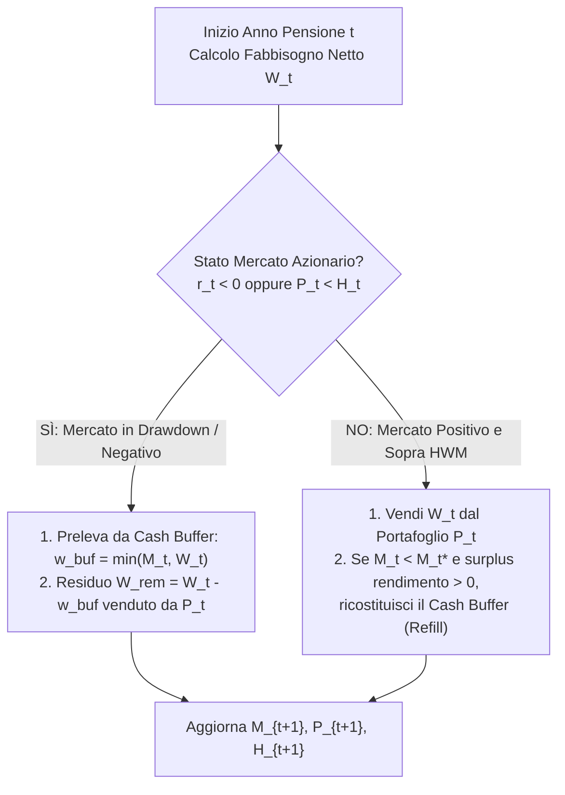

# 11 — Ordine dei Flussi di Cassa Infra-Annuali e Cuscinetto di Liquidità (Cash Buffer)

## 1. Obiettivo e Motivazione

Analizzando il ciclo annuale in [`src/lib/engine/projection.ts`](file:///Users/rlupi/src/fire/FireIta/src/lib/engine/projection.ts#L99-L160), emerge un'asimmetria temporale significativa nel modo in cui vengono applicati i flussi di cassa rispetto al rendimento di mercato (`investmentReturn`):

1. **Fase di Accumulo (righe 99–117)**: Il risparmio netto annuo (`net = income - expenses`) e le eventuali spese una tantum (`oneTimeExpense`) vengono sommati o sottratti al portafoglio **all'inizio dell'anno** ($t + 0$), *prima* di calcolare `investmentReturn = portfolio * returnRate`. Nella realtà, stipendi e spese avvengono su base mensile lungo i 12 mesi dell'anno: assumere che l'intero risparmio annuo sia investito il 1° gennaio sovrastima sistematicamente il compounding di circa mezzo anno di rendimento per ogni contributo.
2. **Fase di Pensionamento / Decumulo (righe 115–159)**: In [`projection.ts`](file:///Users/rlupi/src/fire/FireIta/src/lib/engine/projection.ts#L115-L159), il rendimento annuo (`investmentReturn`) viene applicato all'intero `startPortfolio` **prima** che il pensionato prelevi le spese di vita (`sell(...)`). Ciò equivale a supporre che il pensionato viva per 365 giorni senza spendere nulla e prelevi tutte le spese dell'anno il 31 dicembre *dopo* che il capitale ha reso per l'intero anno.
   - Negli anni con rendimento positivo ($r_t > 0$), questo regala un rendimento fittizio sul denaro già speso durante l'anno.
   - Negli anni di crollo di mercato ($r_t < 0$), il prelievo di fine anno avviene su un portafoglio già decurtato dal drawdown, amplificando artificialmente o distorcendo la quota di unità vendute.
3. **Mancanza di un Cuscinetto di Liquidità (*Cash Buffer / Bucket 1*)**: Una delle strategie più efficaci e diffuse nella comunità FIRE (popolarizzata da *EarlyRetirementNow* e dai modelli *Bucket Strategy* di Evensky) consiste nel mantenere **da 1 a 3 anni di spese correnti** in un cuscinetto separato a rischio zero o quasi-zero (conto deposito svincolabile, BOT, ETF monetario XEON/SMART). Quando il mercato azionario chiude in negativo ($r_t < 0$) o si trova in drawdown rispetto al massimo storico (*High-Water Mark*), le spese di vita vengono attinte dal **Cash Buffer** evitando di liquidare quote azionarie a prezzi depressi; il buffer viene poi ricostituito solo negli anni di mercato fortemente positivo.

---

## 2. Valutazione della Complessità

| Dimensione | Valutazione | Dettagli |
| :--- | :--- | :--- |
| **Stima Effort** | **Media** (2–4 giorni uomo) | La modifica dell'ordine delle operazioni e la convenzione *mid-year* richiedono un refactoring mirato del loop in [`projection.ts`](file:///Users/rlupi/src/fire/FireIta/src/lib/engine/projection.ts), mentre la macchina a stati del Cash Buffer può essere incapsulata in una funzione pura ben isolata. |
| **Impatto Architetturale** | **Basso-Medio** | Nessuna modifica strutturale al campionamento Monte Carlo; estensione pulita di [`Plan`](file:///Users/rlupi/src/fire/FireIta/src/lib/engine/types.ts#L17-L35) e [`YearState`](file:///Users/rlupi/src/fire/FireIta/src/lib/engine/types.ts#L37-L55) e ristrutturazione dell'ordine delle fasi in [`runProjection`](file:///Users/rlupi/src/fire/FireIta/src/lib/engine/projection.ts#L22-L189). |
| **File Coinvolti** | 3 file core + test | [`src/lib/engine/types.ts`](file:///Users/rlupi/src/fire/FireIta/src/lib/engine/types.ts), [`src/lib/engine/projection.ts`](file:///Users/rlupi/src/fire/FireIta/src/lib/engine/projection.ts), [`src/lib/stores/plan.svelte.ts`](file:///Users/rlupi/src/fire/FireIta/src/lib/stores/plan.svelte.ts). |
| **Compatibilità coi Test Esistenti** | **Alta (con flag di default o migrazione esplicita)** | Introducendo `cashflowTiming?: 'legacy' | 'startOfYear' | 'midYear'` (con default `'legacy'` nei test unitari legacy o aggiornamento controllato delle snapshot matematiche), possiamo verificare sia il comportamento storico sia i nuovi regimi temporali. |

---

## 3. Design Tecnico e Modello Matematico

### 3.1 Convenzioni di Timing dei Flussi Infra-Annuali

Sia $P_t$ il portafoglio investito a inizio anno $t$, $r_t$ il rendimento di mercato dell'anno $t$, $C_t \ge 0$ il versamento netto in accumulo e $G_t \ge 0$ la vendita lorda necessaria per finanziare il prelievo netto $W_t$ in decumulo (o il deficit in accumulo).

Definiamo tre modalità per `CashflowTiming`:

1. **`'startOfYear'` (Conservativo standard per il decumulo)**:
   - I prelievi per le spese dell'anno vengono accantonati il 1° gennaio prima dell'esposizione al mercato:
     $$P_t^{\text{post-cf}} = P_t - G_t$$
     $$I_t = P_t^{\text{post-cf}} \cdot r_t, \qquad P_{t+1} = \max(0,\, P_t^{\text{post-cf}} + I_t)$$
   - In questo modo, il capitale destinato alle spese dei 12 mesi successivi non subisce la volatilità azionaria dell'anno in corso.

2. **`'midYear'` (Approssimazione continua per flussi mensili uniformi)**:
   - In un anno in cui un flusso netto $F_t$ (contributo $C_t > 0$ o disinvestimento $-G_t < 0$) avviene in 12 rate mensili costanti, il capitale medio esposto al rendimento annuo $r_t$ è pari al capitale iniziale più **metà** del flusso netto (oppure, in capitalizzazione geometrica esatta, il flusso ottiene il rendimento di metà anno $\sqrt{1 + r_t} - 1 \approx \frac{1}{2}r_t$).
   - **Caso Contributo ($C_t > 0$)**:
     $$I_t = \left(P_t + \frac{1}{2} C_t\right) r_t, \qquad P_{t+1} = \max(0,\, P_t + C_t + I_t)$$
   - **Caso Prelievo ($G_t > 0$ prelevato dal portafoglio investito)**:
     Metà del prelievo annuo avviene all'inizio del primo semestre (non esposto a $r_t$) e metà a metà anno (esposto per metà anno a $r_t$). Equivalentemente, la base effettiva su cui matura il rendimento annuo $r_t$ è:
     $$P_t^{\text{eff}} = \max\!\left(0,\, P_t - \frac{1}{2} G_t\right), \qquad I_t = P_t^{\text{eff}} \cdot r_t, \qquad P_{t+1} = \max(0,\, P_t - G_t + I_t)$$

3. **`'legacy'` (Comportamento attuale per retrocompatibilità)**:
   - Accumulo a $t+0$ (intero $C_t$ investito prima di $r_t$), prelievo in pensione a $t+1$ (dopo $r_t$).

---

### 3.2 Modello Matematico del Cash Buffer Dinamico

Quando la configurazione `cashBuffer` è attiva, il patrimonio totale del piano è suddiviso in due comparti:
- **Portafoglio Investito ($P_t$)** con il proprio `costBasis` ($B_t$), esposto al rendimento stocastico $r_t$ e soggetto a imposta sul capital gain $\tau$ in caso di vendita.
- **Cash Buffer ($M_t$)** (Liquidità / Conto Deposito / Monetario), già al netto di imposte latenti ($B_{\text{cash}} = M_t$), che remunera a un tasso annuo netto o lordo a bassa volatilità $r_{\text{cash}}$ (es. collegato all'inflazione $r_{\text{cash}} = \pi_t + s_{\text{cash}}$ o fisso netto).

#### Parametri del Buffer
- $N_{\text{years}} \in [0, 5]$: numero target di annualità di spese correnti da mantenere nel buffer (es. $2.0$ anni).
- Il livello target del buffer nell'anno $t$ (in pensione) è:
  $$M_t^* = N_{\text{years}} \cdot E_t$$
  dove $E_t$ sono le spese annue correnti rivalutate per l'inflazione.
- **High-Water Mark ($H_t$)**: traccia il massimo valore reale o nominale raggiunto dal portafoglio investito dall'inizio del pensionamento:
  $$H_t = \max(H_{t-1},\, P_t)$$



#### Regole Operative in Fase di Pensionamento ($t \ge t_{\text{ret}}$)

1. **Rendimento sul Cash Buffer**:
   All'inizio dell'anno (o su saldo medio), il buffer matura l'interesse netto:
   $$M_t \leftarrow M_t \cdot (1 + r_{\text{cash,net}})$$

2. **Condizione di Attivazione del Buffer (Protezione SRR)**:
   Definiamo l'indicatore di stress di mercato nell'anno $t$:
   $$\text{isMarketStressed}_t \iff (r_t < \theta_{\text{return}}) \;\lor\; (P_t^{\text{post-return}} < H_t)$$
   dove $\theta_{\text{return}}$ è la soglia di attivazione (default $0$, oppure il tasso d'inflazione $\pi_t$).
   - **Se $\text{isMarketStressed}_t = \text{true}$**:
     Il pensionato **non vende azioni** finché il Cash Buffer è capiente:
     $$W_{\text{fromBuffer}} = \min(M_t,\, W_t)$$
     $$M_t \leftarrow M_t - W_{\text{fromBuffer}}$$
     $$W_{\text{fromPortfolio}} = W_t - W_{\text{fromBuffer}}$$
     Solo $W_{\text{fromPortfolio}}$ viene richiesto a `sell(W_fromPortfolio)` sul portafoglio investito (generando `grossSale` e `taxPaid`).
   - **Se $\text{isMarketStressed}_t = \text{false}$ (Mercato sano)**:
     L'intero fabbisogno $W_t$ viene prelevato dal portafoglio investito tramite `sell(W_t)`.

3. **Regola di Ricostituzione (*Refill*) del Buffer**:
   Se al termine di un anno positivo ($\text{isMarketStressed}_t = \text{false}$ e $r_t > \theta_{\text{refill}}$) il buffer si trova sotto il target ($M_t < M_t^*$), si ricostituisce il deficit:
   $$D_t = M_t^* - M_t$$
   Per evitare di svuotare il portafoglio principale per ricaricare il buffer dopo una timida ripresa, l'importo massimo trasferito dal portafoglio al buffer è limitato al guadagno eccedente dell'anno:
   $$\text{Refill}_t = \min\!\left(D_t,\, \max(0,\, I_t - W_t)\right)$$
   Se $\text{Refill}_t > 0$, si esegue `sell(Refill_t)` dal portafoglio investito e si versa il netto ottenuto in $M_t$.

---

### 3.3 Modifiche alle Interfacce TypeScript (`src/lib/engine/types.ts`)

```typescript
export type CashflowTiming = 'legacy' | 'startOfYear' | 'midYear'

export interface CashBufferConfig {
  enabled: boolean
  /** Numero di anni di spese correnti da mantenere nel buffer (es. 2.0) */
  yearsOfExpenses: number
  /** Rendimento annuo netto della liquidità nel buffer (es. 0.02) */
  cashReturnRate: number
  /** Soglia di rendimento azionario sotto la quale si attinge dal buffer (default: 0) */
  drawdownThreshold: number
}

export interface Plan {
  // ... campi esistenti ...
  cashflowTiming?: CashflowTiming
  cashBuffer?: CashBufferConfig
}

export interface YearState {
  // ... campi esistenti ...
  cashBufferStart?: number
  cashBufferEnd?: number
  bufferWithdrawal?: number
  bufferRefill?: number
}
```

> [!IMPORTANT]
> **Coerenza del Valore Totale del Patrimonio**: Nei grafici e nelle statistiche di successo (`endPortfolio`, `startPortfolio`), bisogna distinguere chiaramente o sommare `investedPortfolio + cashBuffer`. Per mantenere l'invariante contabile con il resto dell'applicazione, `startPortfolio` ed `endPortfolio` in `YearState` rappresenteranno il **patrimonio netto complessivo** ($P_t + M_t$), mentre i campi `cashBufferStart` e `cashBufferEnd` permetteranno alla UI di disegnare l'area impilata (*stacked area*) tra Portafoglio Investito e Cuscinetto di Liquidità.

---

## 4. Step di Implementazione

1. **Aggiornamento di [`src/lib/engine/types.ts`](file:///Users/rlupi/src/fire/FireIta/src/lib/engine/types.ts)**:
   - Definire `CashflowTiming` e `CashBufferConfig`.
   - Estendere `Plan` con `cashflowTiming?: CashflowTiming` e `cashBuffer?: CashBufferConfig`.
   - Estendere `YearState` con `cashBufferStart`, `cashBufferEnd`, `bufferWithdrawal` e `bufferRefill`.

2. **Creazione dell'helper di determinazione del prelievo in [`src/lib/engine/projection.ts`](file:///Users/rlupi/src/fire/FireIta/src/lib/engine/projection.ts)**:
   - Estrarre il calcolo del fabbisogno annuo in pensione (`computeRetirementNeed(plan, year, stop, startTotalPortfolio, currentPortfolio, expenses, oneTimeExpenses, stateTrackers)`) in una funzione pura separata dall'esecuzione materiale di `sell(...)`, così da poterla invocare a inizio anno, metà anno o fine anno senza duplicare la logica di `percentCap` e `guardrails`.

3. **Implementazione di `CashflowTiming` in [`runProjection`](file:///Users/rlupi/src/fire/FireIta/src/lib/engine/projection.ts#L22-L189)**:
   - Gestire i 3 rami (`'legacy'`, `'startOfYear'`, `'midYear'`):
     - In `'startOfYear'`, eseguire sia i contributi/deficit di accumulo sia i prelievi di pensione *prima* del calcolo di `investmentReturn`.
     - In `'midYear'`, calcolare il flusso netto all'inizio, applicare `returnRate` a `portfolio + 0.5 * contribution` (in accumulo) o `portfolio - 0.5 * grossSale` (in decumulo).

4. **Implementazione della macchina a stati del `CashBuffer`**:
   - All'anno $t = \text{stop}$ (inizio pensionamento), o gradualmente negli anni precedenti se integrato col Glidepath, allocare $M_{\text{stop}} = \min(\text{portfolio}, N_{\text{years}} \cdot E_{\text{stop}})$ scorporandolo dal portafoglio investito (o inizializzandolo dalla quota liquidità).
   - Negli anni di pensionamento ($t \ge \text{stop}$), applicare la logica di prelievo protetto ($\text{isMarketStressed}_t$) e la successiva regola di *Refill* sugli anni con $I_t > W_t$.

5. **Aggiornamento dello Store [`src/lib/stores/plan.svelte.ts`](file:///Users/rlupi/src/fire/FireIta/src/lib/stores/plan.svelte.ts)**:
   - Inizializzare i valori di default nel piano reattivo (`cashflowTiming: 'midYear'`, `cashBuffer: { enabled: false, yearsOfExpenses: 2, cashReturnRate: 0.02, drawdownThreshold: 0 }`).

---

## 5. Piano di Test e Verifica

I test saranno aggiunti in `src/lib/engine/__tests__/cashflow-buffer.test.ts` (Vitest):

1. **Test Deterministico Timing `startOfYear` vs `legacy` in Pensione**:
   - *Setup*: `initialPortfolio = 100_000`, `initialCostBasis = 100_000` (zero tasse per isolare l'effetto matematico), `retirementAge = currentAge` (subito in pensione), `annualExpenses = 10_000`, `returnRate = +0.10` costante per 1 anno.
   - *Verifica*:
     - Con `cashflowTiming: 'legacy'`: $P_1 = 100\,000 \times 1.10 - 10\,000 = 100\,000$ (`investmentReturn = 10_000`).
     - Con `cashflowTiming: 'startOfYear'`: $P_1 = (100\,000 - 10\,000) \times 1.10 = 99\,000$ (`investmentReturn = 9_000`).
     - Con `cashflowTiming: 'midYear'`: $P_1 = 100\,000 - 10\,000 + (100\,000 - 5\,000) \times 0.10 = 99\,500$ (`investmentReturn = 9_500`).

2. **Test Mitigazione Sequence of Returns Risk col Cash Buffer**:
   - *Setup*: Portafoglio iniziale `500_000` (`costBasis = 300_000`, `taxRate = 0.26`), spese annue `20_000`, sequenza di rendimenti nei primi 3 anni di pensione: `[-0.25, -0.15, +0.35]`. Confronto tra piano senza buffer e piano con `cashBuffer: { enabled: true, yearsOfExpenses: 2, cashReturnRate: 0.0, drawdownThreshold: 0 }`.
   - *Verifica*:
     - Negli anni 0 e 1 ($r_0 = -25\%, r_1 = -15\%$), il piano con Cash Buffer registra `grossSale === 0` e `taxPaid === 0` sul portafoglio azionario, prelevando interamente `bufferWithdrawal = 20_000` dal buffer.
     - Al termine dell'anno 2 ($r_2 = +35\%$), il patrimonio finale `endPortfolio` del piano con Cash Buffer è significativamente superiore a quello del piano senza buffer, poiché non ha liquidato quote azionarie ai minimi degli anni 0 e 1 né pagato imposte durante il drawdown.

3. **Test di Esaurimento Parziale del Buffer e Fallback sul Portafoglio**:
   - *Setup*: Buffer residuo $M_t = 12\,000$, spesa annua $W_t = 20\,000$ in un anno con $r_t = -0.10$.
   - *Verifica*: `bufferWithdrawal` è esattamente `12_000`, `cashBufferEnd` scende a `0`, e la funzione `sell(...)` sul portafoglio investito viene invocata esclusivamente per la differenza netta residua di `8_000`.

4. **Test Regola di Refill Condizionato**:
   - *Setup*: Buffer scarico ($M_t = 0$, target $M_t^* = 40\,000$), anno con piccolo rendimento positivo in cui il guadagno azionario è $I_t = 30\,000$ e la spesa ordinaria è $W_t = 20\,000$.
   - *Verifica*: Il refill non preleva l'intero deficit di $40\,000$, ma si limita all'eccedenza di rendimento $\max(0, I_t - W_t) = 10\,000$, preservando il capitale reale del portafoglio principale.
