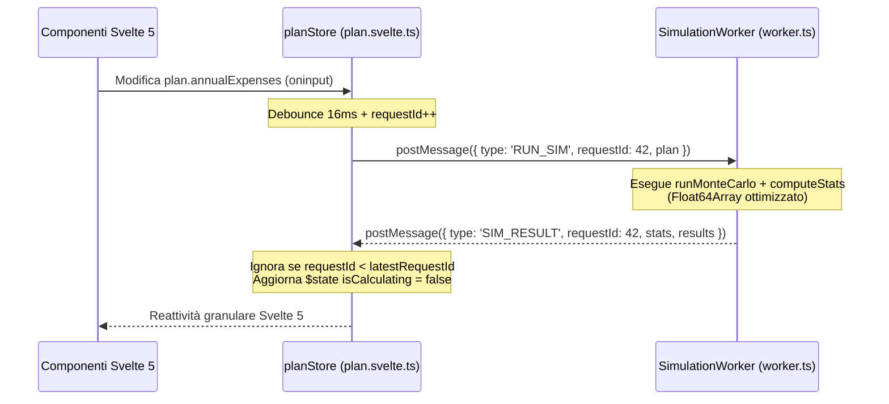

# 12 — Esecuzione Asincrona via Web Worker, Ottimizzazione Memoria e Risolutore Inverso ("Goal Seek")

## 1. Obiettivo e Motivazione

L'architettura reattiva attuale di FireIta presenta tre colli di bottiglia computazionali e funzionali che emergono non appena l'utente interagisce rapidamente con i controlli della UI o aumenta il numero di simulazioni (`runs`):

1. **Blocco del Main Thread UI in [`src/lib/stores/plan.svelte.ts`](file:///Users/rlupi/src/fire/FireIta/src/lib/stores/plan.svelte.ts#L26-L27)**:
   Attualmente lo store utilizza due rune `$derived` sincrone:
   ```typescript
   const results: SimResult[] = $derived(runMonteCarlo(plan))
   const stats: SimStats = $derived(computeStats(results))
   ```
   Ogni singolo evento `oninput` (es. trascinamento di uno slider o digitazione in un campo numerico) ricalcola in modo sincrono sul thread principale $1\,000$ (o $10\,000$) traiettorie complete per 50–60 anni e ne ordina i percentili anno per anno. Con $N = 5\,000$ run, questo blocca il rendering del browser per 80–250 ms ad ogni frame, causando *input lag* e *jank* visivo.
2. **Inefficienza di Memoria e CPU in [`src/lib/engine/stats.ts`](file:///Users/rlupi/src/fire/FireIta/src/lib/engine/stats.ts#L48-L65)**:
   Per un piano con $N = 10\,000$ run e un orizzonte $H = 60$ anni:
   - `runMonteCarlo` alloca $10\,000 \times 60 = 600\,000$ oggetti JavaScript [`YearState`](file:///Users/rlupi/src/fire/FireIta/src/lib/engine/types.ts#L37-L55) (ciascuno di 18 proprietà), occupando decine di megabyte nell'heap V8 e innescando frequenti cicli di Garbage Collection (Major GC).
   - `computeStats` crea per ciascuno dei $60$ anni un nuovo array `results.map(...).sort(...)` di lunghezza $N$, più due ordinamenti completi finali (`finals` e `sortedByFinal`), per un totale di $H + 2$ allocazioni e ordinamenti $O(N \log N)$.
3. **Assenza di un Risolutore Inverso ("Goal Seek")**:
   Chi pianifica il proprio percorso FIRE raramente vuole solo sapere *"qual è la probabilità di successo con questi parametri?"*; le domande fondamentali sono inverse:
   - *"Qual è la **prima età (o anno)** in cui posso andare in pensione avendo almeno il **90% di probabilità di successo**?"*
   - *"Quanto devo **risparmiare in più all'anno** (`annualIncome` a parità di spese) per raggiungere il 95% di successo a 50 anni?"*
   - *"Qual è la **spesa annua massima sostenibile** (`annualExpenses`) che mantiene il rischio di fallimento sotto il 5%?"*
   Risolvere queste domande richiede di eseguire la simulazione Monte Carlo decine di volte all'interno di un algoritmo di ottimizzazione (ricerca binaria / bisezione), operazione fattibile in pochi millisecondi solo se combinata con una modalità *fast-stat* leggera eseguita in un **Web Worker**.

---

## 2. Valutazione della Complessità

| Dimensione | Valutazione | Dettagli |
| :--- | :--- | :--- |
| **Stima Effort** | **Media-Alta** (4–6 giorni uomo) | Richiede l'introduzione di un Web Worker Vite (`new Worker(new URL(..., import.meta.url), { type: 'module' })`), gestione di `requestId` per annullare richieste obsolete, refactoring di `stats.ts` con `Float64Array` preallocati e creazione del modulo `goalSeek.ts`. |
| **Impatto Architetturale** | **Medio** | Separa il calcolo intensivo dal ciclo di rendering Svelte 5, mantenendo tuttavia un fallback sincrono trasparente per l'ambiente di test Node/Vitest dove `Worker` non è necessario. |
| **File Coinvolti** | 2 file esistenti + 3 nuovi | Modifica di [`src/lib/engine/stats.ts`](file:///Users/rlupi/src/fire/FireIta/src/lib/engine/stats.ts) e [`src/lib/stores/plan.svelte.ts`](file:///Users/rlupi/src/fire/FireIta/src/lib/stores/plan.svelte.ts); creazione di `src/lib/engine/goalSeek.ts`, `src/lib/engine/worker.ts` e `src/lib/engine/__tests__/goalSeek.test.ts`. |
| **Compatibilità coi Test Esistenti** | **100% Retrocompatibile** | Le firme pubbliche di `runMonteCarlo(plan)` e `computeStats(results)` restano identiche. |

---

## 3. Design Tecnico e Modello Matematico

### 3.1 Ottimizzazione Memoria e Complessità di `computeStats`

In [`src/lib/engine/stats.ts`](file:///Users/rlupi/src/fire/FireIta/src/lib/engine/stats.ts), possiamo abbattere il consumo di memoria e il tempo di CPU attraverso tre interventi:

1. **Buffer Tipizzato Riutilizzabile (`Float64Array`) per le Bande Annuali**:
   Invece di allocare $H$ array JavaScript boxed tramite `results.map((r) => r.years[year].endPortfolio).sort(...)`, allochiamo **un unico buffer** `const colBuffer = new Float64Array(runCount)` fuori dal ciclo sugli anni:
   ```typescript
   const colBuffer = new Float64Array(runCount)
   for (let year = 0; year < yearCount; year++) {
     for (let r = 0; r < runCount; r++) {
       colBuffer[r] = results[r].years[year].endPortfolio
     }
     colBuffer.sort() // In-place C++ radix/timsort su Float64 nativi, zero GC!
     bands.push({
       year,
       age: results[0].years[year].age,
       p10: percentileTyped(colBuffer, 10),
       // ...
     })
   }
   ```
   `Float64Array.prototype.sort()` opera direttamente su float a 64 bit contigui in memoria senza callback JS `(a, b) => a - b`, risultando **da 4x a 7x più veloce** e producendo **zero garbage**.

2. **Eliminazione del Doppio Ordinamento Finale**:
   Attualmente `computeStats` ordina sia `finals` (riga 42) sia `sortedByFinal` (riga 63). Ordinando una sola volta un array di indici o direttamente `sortedByFinal`, ricaviamo sia `medianRun` sia `finalPercentiles` con un unico sort.

3. **Modalità `evaluateSuccessRate(plan: Plan): number` Zero-Allocation (per Goal Seek)**:
   Quando il risolutore inverso cerca il valore ottimo di un parametro, non ha bisogno delle bande annuali né degli oggetti `YearState[]`. Una funzione dedicata `evaluateSuccessRate(plan: Plan)` esegue il loop Monte Carlo mantenendo in memoria solo le variabili scalari `portfolio` e `costBasis` lungo gli anni, senza mai allocare l'array `states: YearState[]`. Questo riduce il tempo di una singola valutazione di 1.000 run da ~15 ms a **< 1.5 ms**.

---

### 3.2 Formulazione Matematica del Risolutore Inverso ("Goal Seek")

Sia $\theta \in [\theta_{\min}, \theta_{\max}]$ il parametro decisionale che l'utente desidera ottimizzare, scegliendo tra:
1. **Spese annue sostenibili** ($\theta = E_0 = \text{annualExpenses}$), dove la funzione di successo $S(\theta)$ è **monotona decrescente** ($\frac{\partial S}{\partial E_0} \le 0$).
2. **Reddito / Risparmio annuo richiesto** ($\theta = Y_0 = \text{annualIncome}$), dove $S(\theta)$ è **monotona crescente** ($\frac{\partial S}{\partial Y_0} \ge 0$).
3. **Patrimonio iniziale richiesto** ($\theta = P_0 = \text{initialPortfolio}$), dove $S(\theta)$ è **monotona crescente** ($\frac{\partial S}{\partial P_0} \ge 0$).
4. **Età di pensionamento minima** ($\theta = A_{\text{ret}} = \text{retirementAge} \in \mathbb{Z}$), dove $S(\theta)$ è **monotona crescente** rispetto all'età di ritiro (assumendo risparmio positivo $Y_t > E_t$ in accumulo).

Fissato il seme del generatore pseudocasuale (`plan.seed`), la funzione empirica di successo su $N$ simulazioni:
$$S(\theta; \text{seed}) = \frac{1}{N} \sum_{k=1}^N \mathbb{I}\!\left(\text{run } k \text{ non esaurisce il capitale con parametro } \theta\right)$$
è una funzione **deterministica, monotona a gradini** (*step function*) grazie all'uso di **Common Random Numbers (CRN)**: poiché ogni iterazione della ricerca binaria riutilizza esattamente la stessa sequenza di numeri casuali generata da `mulberry32(plan.seed)`, $S(\theta)$ non soffre di rumore stocastico tra un'iterazione e l'altra e gode di monotonia stretta rispetto all'ordinamento parziale delle traiettorie!

#### Algoritmo di Bisezione Monotona (Variabili Continue: `annualExpenses`, `annualIncome`, `initialPortfolio`)

Dato un target $S^* \in (0, 1)$ (es. $S^* = 0.90$), un intervallo iniziale $[a_0, b_0]$ e una tolleranza sul parametro $\varepsilon_\theta$ (es. $\varepsilon_\theta = 50\text{ €}$):

1. Sia $\sigma \in \{+1, -1\}$ la direzione di monotonia ($\sigma = +1$ se $S$ cresce con $\theta$, $\sigma = -1$ se decresce, come per `annualExpenses`).
2. Verifica di fattibilità agli estremi:
   - Definiamo $\theta_{\text{best}} = b_0$ se $\sigma = +1$ (oppure $a_0$ se $\sigma = -1$) e $\theta_{\text{worst}}$ l'estremo opposto.
   - Se $S(\theta_{\text{best}}) < S^*$, il target è irraggiungibile nell'intervallo: restituisci `{ status: 'unreachable', bestPossibleRate: S(theta_best) }`.
   - Se $S(\theta_{\text{worst}}) \ge S^*$, il target è già soddisfatto al minimo sforzo: restituisci `{ status: 'alreadyMet', value: theta_worst, achievedRate: S(theta_worst) }`.
3. Per $k = 1, \dots, K_{\max}$ (con $K_{\max} = \lceil \log_2((b_0 - a_0)/\varepsilon_\theta) \rceil \approx 18$ iterazioni):
   $$m_k = \frac{a_{k-1} + b_{k-1}}{2}$$
   Valutiamo $s_k = S(m_k; \text{seed})$.
   - Se $\sigma = +1$: se $s_k \ge S^*$ cerchiamo un valore ancora minore ($b_k = m_k$), altrimenti $a_k = m_k$.
   - Se $\sigma = -1$ (`annualExpenses`): se $s_k \ge S^*$ possiamo spendere di più ($a_k = m_k$), altrimenti dobbiamo spendere meno ($b_k = m_k$).
   - Se $|b_k - a_k| \le \varepsilon_\theta$, terminiamo restituendo l'estremo conservativo che garantisce $S(\hat{\theta}) \ge S^*$.

#### Ricerca Binaria Discreta (Variabile Intera: `retirementAge`)
Per $\theta = A_{\text{ret}} \in \{A_{\text{curr}}, A_{\text{curr}} + 1, \dots, A_{\text{life}} - 1\}$, l'intervallo ha ampiezza massima $\le 70$ anni: una ricerca binaria intera trova l'età minima esatta $A_{\text{ret}}^* = \min \{ A \in \mathbb{Z} : S(A) \ge S^* \}$ in al più $\lceil \log_2(70) \rceil = 7$ valutazioni!

---

### 3.3 Architettura Asincrona con Web Worker e Protocollo Messaggi



#### Interfacce TypeScript per `src/lib/engine/goalSeek.ts` e `src/lib/engine/worker.ts`

```typescript
// src/lib/engine/goalSeek.ts
import type { Plan } from './types'

export type GoalSeekTargetParam =
  | 'retirementAge'
  | 'annualExpenses'
  | 'annualIncome'
  | 'initialPortfolio'

export interface GoalSeekRequest {
  plan: Plan
  param: GoalSeekTargetParam
  targetSuccessRate: number // es. 0.90
  minBound?: number
  maxBound?: number
  tolerance?: number // default: 1 per retirementAge, 100 (€) per importi monetari
  maxIterations?: number // default: 25
}

export interface GoalSeekResult {
  status: 'converged' | 'unreachable' | 'alreadyMet'
  param: GoalSeekTargetParam
  optimalValue: number
  achievedSuccessRate: number
  iterations: number
}
```

```typescript
// Protocollo messaggi per src/lib/engine/worker.ts
import type { Plan, SimResult } from './types'
import type { SimStats } from './stats'
import type { GoalSeekRequest, GoalSeekResult } from './goalSeek'

export type WorkerRequest =
  | { type: 'SIMULATE'; requestId: number; plan: Plan; includeAllRuns?: boolean }
  | { type: 'GOAL_SEEK'; requestId: number; payload: GoalSeekRequest }

export type WorkerResponse =
  | {
      type: 'SIMULATE_DONE'
      requestId: number
      stats: SimStats
      results: SimResult[]
      durationMs: number
    }
  | {
      type: 'GOAL_SEEK_DONE'
      requestId: number
      result: GoalSeekResult
      durationMs: number
    }
  | { type: 'ERROR'; requestId: number; message: string }
```

---

## 4. Step di Implementazione

1. **Ottimizzazione di [`src/lib/engine/stats.ts`](file:///Users/rlupi/src/fire/FireIta/src/lib/engine/stats.ts)**:
   - Introdurre `percentileTyped(sortedValues: Float64Array, p: number): number`.
   - Sostituire le allocazioni `.map().sort()` nel loop `for (let year = 0; year < yearCount; year++)` con un singolo `Float64Array(results.length)` riutilizzato ad ogni iterazione.
   - Unificare l'ordinamento di `sortedByFinal` e `finals` per dimezzare i sort sull'intero array dei risultati.

2. **Creazione di `src/lib/engine/goalSeek.ts`**:
   - Implementare `evaluateSuccessRateFast(plan: Plan): number` (o riutilizzare `runMonteCarlo` con flag leggero) garantendo l'identico utilizzo di `mulberry32(plan.seed)` (Common Random Numbers).
   - Implementare `solveGoalSeek(req: GoalSeekRequest): GoalSeekResult` con supporto sia per il caso discreto (`retirementAge`) sia per i parametri continui (`annualExpenses`, `annualIncome`, `initialPortfolio`) e definizione automatica di bound sensati di default (es. `annualExpenses` $\in [0, \text{initialPortfolio} \times 0.20 + \text{annualIncome}]$).

3. **Creazione del Web Worker `src/lib/engine/worker.ts`**:
   - Gestire gli eventi `onmessage` tipizzati con `WorkerRequest`, eseguendo `runMonteCarlo` + `computeStats` per `'SIMULATE'` e `solveGoalSeek` per `'GOAL_SEEK'`.
   - Per ridurre il costo di *structured clone* tra Worker e Main Thread quando `runs > 2_000`, se `includeAllRuns` è `false`, inviare solo `stats` (che contiene già `bands` e `medianRun` necessario per la tabella di dettaglio), azzerando il payload di trasferimento IPC da ~15 MB a < 20 KB.

4. **Aggiornamento dello Store [`src/lib/stores/plan.svelte.ts`](file:///Users/rlupi/src/fire/FireIta/src/lib/stores/plan.svelte.ts)**:
   - Mantenere una computazione iniziale sincrona (per SSR / primo render istantaneo e test unitari in ambiente privo di `Worker`).
   - In ambiente browser (`typeof Worker !== 'undefined'`), istanziare il worker e usare `$effect` con un debounce di `16ms` (1 frame a 60Hz) e contatore incrementale `requestId` per inviare gli aggiornamenti di `$state.snapshot(plan)` al worker.
   - Esporre `isCalculating: boolean` e il metodo asincrono `runGoalSeek(param, targetSuccessRate): Promise<GoalSeekResult>` direttamente dallo store.

---

## 5. Piano di Test e Verifica

I test saranno collocati in `src/lib/engine/__tests__/goalSeek.test.ts` e `src/lib/engine/__tests__/stats.test.ts` (Vitest):

1. **Invarianza Bit-per-Bit di `computeStats` Ottimizzato**:
   - *Setup*: Eseguire `runMonteCarlo` con $N = 1\,000$ run su un piano standard e confrontare l'output del nuovo `computeStats` basato su `Float64Array` con i valori di riferimento.
   - *Verifica*: `successRate`, `finalPercentiles`, `meanDepletionAge`, `bands` e `medianRun` coincidono al bit (`toEqual`) con l'implementazione precedente.

2. **Convergenza Esatta di `solveGoalSeek` su `annualExpenses`**:
   - *Setup*: Piano con `initialPortfolio = 1_000_000`, `retirementAge = currentAge`, `runs = 500`, `seed = 42`, `targetSuccessRate = 0.90`, `tolerance = 50`.
   - *Verifica*:
     - `result.status === 'converged'`.
     - Eseguendo una verifica diretta con `annualExpenses = result.optimalValue`, il `successRate` risultante è $\ge 0.90$.
     - Eseguendo una verifica diretta con `annualExpenses = result.optimalValue + tolerance`, il `successRate` risultante è strettamente $< 0.90$ (prova costruttiva di ottimalità nella griglia di tolleranza).

3. **Convergenza Discreta di `solveGoalSeek` su `retirementAge`**:
   - *Setup*: Utente di 35 anni (`startYear = 2026, birthYear = 1991`), `initialPortfolio = 150_000`, `annualIncome = 45_000`, `annualExpenses = 25_000`, `targetSuccessRate = 0.95`.
   - *Verifica*:
     - Il solver converge in $\le 8$ iterazioni a un'età intera $A^* \in (35, 95)$.
     - A età $A^*$ il tasso di successo è $\ge 0.95$, mentre a età $A^* - 1$ il tasso di successo è $< 0.95$.

4. **Gestione dei Casi Limite (`alreadyMet` e `unreachable`)**:
   - *Setup 1 (`alreadyMet`)*: `initialPortfolio = 10_000_000`, `annualExpenses = 20_000`, ricerca di `retirementAge` per `targetSuccessRate = 0.95`. Verifica che restituisca immediatamente l'età corrente con `status: 'alreadyMet'` in 1–2 valutazioni.
   - *Setup 2 (`unreachable`)*: `initialPortfolio = 0`, `annualIncome = 10_000`, `annualExpenses = 50_000`, ricerca di `retirementAge` nel range $[35, 90]$. Verifica che restituisca `status: 'unreachable'`.
